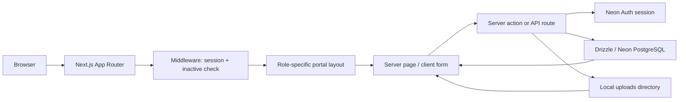
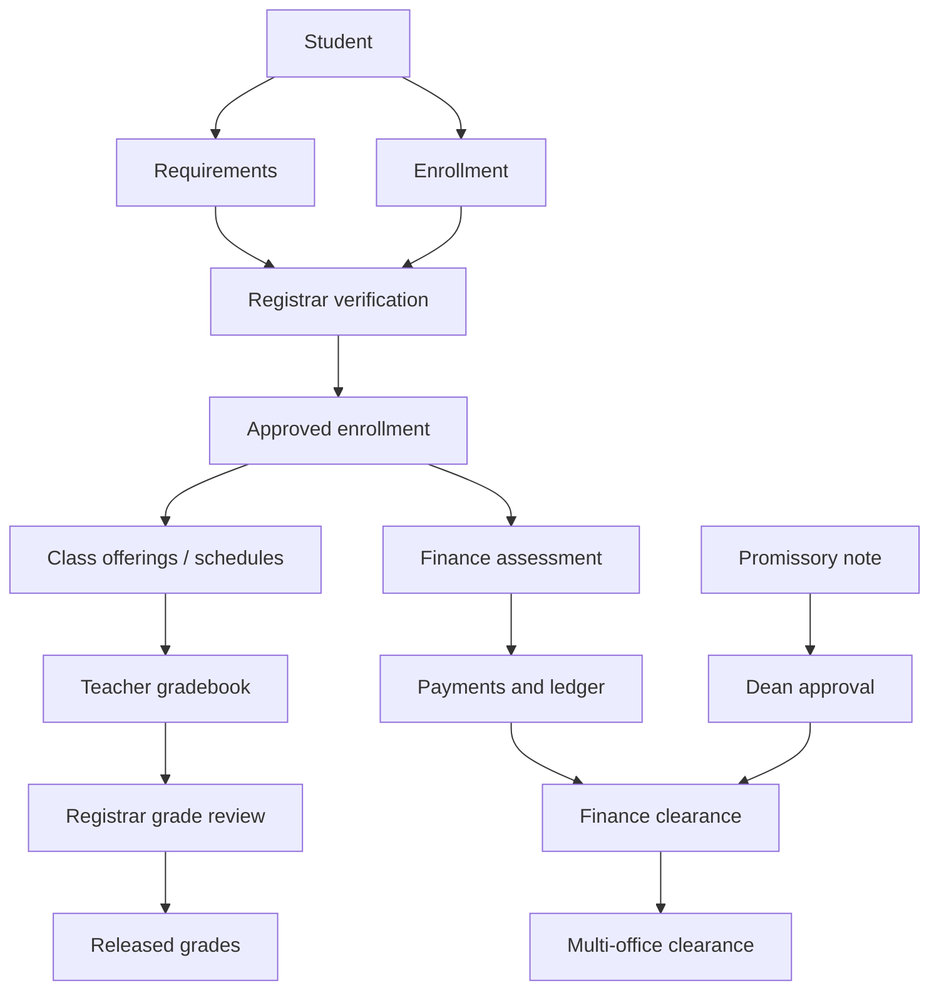
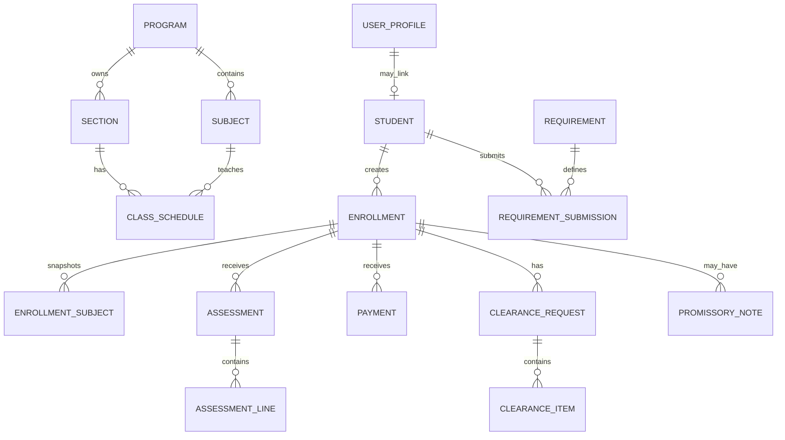

# CORUS School Portal

CORUS is a role-based school administration portal for student onboarding,
academic setup, enrollment, scheduling, grades, requirements, billing,
clearance, announcements, and administrative support. It is implemented as a
Next.js App Router application with server actions, API route handlers,
Neon Auth, PostgreSQL, and Drizzle ORM.

This README describes the implementation currently present in this repository.
It intentionally distinguishes working code from legacy routes, placeholders,
and procedures that have not been verified here.

## Table of contents

- [Project overview](#project-overview)
- [Current status and limitations](#current-status-and-limitations)
- [Roles and permissions](#roles-and-permissions)
  - [Role summary](#role-summary)
  - [Role assignment and account lifecycle](#role-assignment-and-account-lifecycle)
  - [Role-permission matrix](#role-permission-matrix)
  - [Backend enforcement versus interface visibility](#backend-enforcement-versus-interface-visibility)
- [How the system works](#how-the-system-works)
  - [Authentication and onboarding](#authentication-and-onboarding)
  - [Major modules](#major-modules)
  - [Important workflows and statuses](#important-workflows-and-statuses)
  - [Role-based examples](#role-based-examples)
- [Architecture and technology](#architecture-and-technology)
  - [Request and data flow](#request-and-data-flow)
  - [Directory structure](#directory-structure)
  - [Diagrams](#diagrams)
- [Database and data model](#database-and-data-model)
  - [Main entities](#main-entities)
  - [Relationships](#relationships)
  - [Migrations, seed data, and deletion behavior](#migrations-seed-data-and-deletion-behavior)
- [Installation and configuration](#installation-and-configuration)
- [Developer guide](#developer-guide)
  - [Scripts](#scripts)
  - [Routes and API handlers](#routes-and-api-handlers)
  - [Adding features and permissions](#adding-features-and-permissions)
- [Deployment and operations](#deployment-and-operations)
- [Troubleshooting and FAQ](#troubleshooting-and-faq)
- [Known gaps and references](#known-gaps-and-references)

## Project overview

### Purpose and users

The portal centralizes operational work that is otherwise spread across
registrar records, academic setup, spreadsheets, finance ledgers, paper
clearance forms, and teacher grade submissions. It serves:

- **Students**, who complete profiles, submit requirements, enroll, view
  schedules and grades, review billing, and participate in clearance.
- **Teachers**, who view assigned classes and schedules, maintain gradebooks,
  and submit grades for registrar review.
- **Registrars**, who maintain academic master data and student records,
  review enrollment and requirements, manage schedules and staff records, and
  review grade submissions.
- **Finance staff**, who configure fees, create and post assessments, record
  and void payments, manage balances, handle finance clearance, and produce
  collections reports.
- **Program heads**, who work within assigned program scope to manage sections,
  scheduling, teacher capabilities, sectioning, enrollment analytics, and
  program-level finance/grades views.
- **Deans**, who review cross-module approvals, promissory notes, schedules,
  teacher capabilities, governance flags, and institutional views.
- **Administrators**, who manage users, roles, programs, settings, audit
  records, support requests, data tools, and system health.

### Implemented feature areas

- Email/password registration and login through Neon Auth.
- Email OTP verification during self-service registration.
- Server-side role-based portal routing.
- Student profile completion, emergency contacts, addresses, prior schools,
  and student-type information.
- School years, terms, grading periods, programs, subjects, sections,
  curriculum versions, class schedules, teacher assignments, and adviser
  assignments.
- Student enrollment submission and registrar approval/rejection.
- Requirement rules, uploads, verification/rejection, and “to follow”
  handling.
- Teacher capabilities and teacher grade submissions with registrar review.
- Fee items, program fee rules, fee setup approval, assessments, ledger
  entries, payments, receipts, balances, and collection reporting.
- Multi-office clearance and finance holds.
- Promissory notes with dean approval and installment schedules.
- Audience-targeted announcements.
- Dean governance flags.
- Admin user activation, password update, role changes, local profile
  creation, audit log viewing, support requests, data tools, and health view.
- PDF/print-oriented assessment, receipt, clearance, and promissory-note
  pages.

## Current status and limitations

The codebase is an active, evolving application rather than a finished
product. The following points are verified from source:

- There is no `test` or `format` script in [`package.json`](package.json).
  Validation currently consists of linting, TypeScript checking, and builds.
- Uploads default to a local `uploads/` directory. The requirement file API
  contains a TODO for S3 presigned URLs; production object-storage support is
  not implemented in this repository.
- Several old URLs are redirected to newer pages in
  [`next.config.ts`](next.config.ts) and [`middleware.ts`](middleware.ts).
  The redirected pages should not be treated as separate current modules.
- The database contains both newer normalized entities and legacy-compatible
  tables/views, including legacy grade tables and denormalized `program`
  fields. See [`db/schema.ts`](db/schema.ts) and
  [`docs/schema-mapping.md`](docs/schema-mapping.md).
- `user_role_grants` exists as an optional multi-role table, but the active
  profile authorization path uses the single `user_profile.role` value.
- Some helper functions require only the named operational role, while many
  actions explicitly allow `admin`. Admin access therefore should not be
  inferred solely from helper names; inspect the action being changed.
- The repository includes audit and refactor notes describing known UX and
  flow issues. These are references, not proof that every item is resolved:
  [`docs/audit/student-flow-audit.md`](docs/audit/student-flow-audit.md),
  [`docs/audit/registrar-flow-audit.md`](docs/audit/registrar-flow-audit.md),
  [`docs/audit/finance-flow-audit.md`](docs/audit/finance-flow-audit.md).
- No deployment manifest, CI workflow, backup job, scheduled worker, email
  notification worker, or external object-storage adapter is present in the
  repository. Deployment guidance below is therefore limited to the
  Next.js/Node process and configured database/auth services.

## Roles and permissions

### Role summary

The authoritative role enum is in [`db/schema.ts`](db/schema.ts), and labels
and home paths are in [`lib/roles.ts`](lib/roles.ts).

| Role | Home | Purpose and main responsibilities |
|---|---|---|
| `student` | `/student` | Own profile, requirements, enrollment, clearance, grades, schedule, announcements, and billing. |
| `teacher` | `/teacher` | Assigned classes, class schedules, gradebook entries, and grade submissions. |
| `registrar` | `/registrar` | Student/academic records, programs, subjects, sections, curricula, schedules, requirements, enrollment approvals, staff, and grade review. |
| `finance` | `/finance` | Fee setup, assessments, payments, balances, collections, finance clearance, and finance announcements. |
| `program_head` | `/program-head` | Scoped program operations: capabilities, sections, schedules, sectioning, analytics, grades, finance views, clearance, and announcements. |
| `dean` | `/dean` | Institutional approvals, enrollments, academics, finance, operations, promissory notes, governance, and announcements. |
| `admin` | `/admin` | User and role administration, program assignments, settings, audit/support/data tools, and health. Many operational actions also explicitly allow admins. |

#### Student

The student navigation is defined in
[`components/portal/nav/student.ts`](components/portal/nav/student.ts):
Dashboard, Forms & requirements, Enrollment, Clearance, Grades, Schedule,
Announcements, Billing, and Profile.

Students can register themselves, verify email, complete their profile, upload
requirement files, mark eligible requirements as “to follow” when the setting
allows it, submit enrollment, view enrollment decisions, view released grades,
view schedules, inspect assessments/receipts, and participate in clearance.
Student queries are keyed to the current authenticated student and do not
provide a general student search interface.

Students cannot approve their own enrollment, verify their own requirements,
post payments, alter fee setup, review grades, or approve clearance items.

#### Teacher

The teacher navigation is defined in
[`components/portal/nav/teacher.ts`](components/portal/nav/teacher.ts):
Dashboard, My Classes, Schedule, Gradebook, and Submissions.

Teacher access depends on both the `teacher` role and a usable teacher profile
context. The layout calls `ensureTeacherForCurrentUser`; a role alone is not
enough if the teacher record/context cannot be resolved. Teachers work on
assigned schedules/classes, enter grades for grading periods, save drafts, and
submit grade submissions for registrar review.

The teacher is not the final approver of submitted grades. Registrar review
and release fields are stored on `grade_submissions`.

#### Registrar

The registrar navigation is defined in
[`components/portal/nav/registrar.ts`](components/portal/nav/registrar.ts):
Dashboard, Approvals & Compliance, Grades, Records, Academics, Scheduling,
Staff, and Announcements.

Registrar responsibilities include:

- Reviewing enrollment applications and requirement submissions.
- Creating and maintaining students and student records.
- Managing programs, subjects, sections, curriculum versions, schedules,
  adviser assignments, and teacher records/capabilities support.
- Reviewing grade submissions and taking the available review actions.
- Publishing announcements for the registrar audience or broader audiences.

Registrar pages generally allow `registrar` and `admin`; registrar-specific
server actions normally use `requireRole(["registrar", "admin"])`.

#### Finance

The finance navigation is defined in
[`components/portal/nav/finance.ts`](components/portal/nav/finance.ts):
Dashboard, Assessments, Payments, Student Balances, Collections Report, Fee
Setup, Clearance, and Announcements.

Finance staff maintain fee items/rules and fee setup drafts, submit fee setups
into the approval workflow, generate or edit assessments for approved
enrollments, post assessments, record/void payments, inspect balances, mark
finance clearance items, put enrollments on hold, create promissory notes, and
produce collections reports.

Payment posting and most finance mutations are protected by
`requireRole(["finance", "admin"])`. The standalone helpers in
[`lib/fees/permissions.ts`](lib/fees/permissions.ts) are stricter and accept
only `finance`, `program_head`, or `dean` as named; do not reuse them without
checking whether admin access is intended.

#### Program head

The program-head navigation is defined in
[`components/portal/nav/programHead.ts`](components/portal/nav/programHead.ts):
Dashboard, Teacher Capabilities, Sections, Scheduling, Smart Sectioning,
Enrollment Analytics, Grades, Announcements, and Settings.

Program heads can create/update/deactivate sections, manage scheduling,
submit time configurations, run smart sectioning, inspect program enrollments
and grades, maintain teacher capability packages, and participate in
program-level clearance/fee workflows.

Program-head data is scope-sensitive. Scope comes from `user_profile.program`
or active rows in `program_head_assignments`. `ALL` means all programs.
If no scope is configured, scope-gated pages can display a configuration
state rather than silently treating the user as a single-program operator.
The scope implementation is in
[`lib/programHead/scope.ts`](lib/programHead/scope.ts).

#### Dean

The dean navigation is defined in
[`components/portal/nav/dean.ts`](components/portal/nav/dean.ts):
Dashboard, Approvals, Promissory notes, Enrollments, Academics, Finance,
Operations, Announcements, Governance, and Settings.

The dean is the approval authority for the implemented dean approval flows,
including fee setups, schedule/time configuration, teacher capabilities,
promissory notes, and governance flag resolution where the corresponding
actions expose it. The approvals hub consolidates several legacy approval
routes.

#### Admin

Admin navigation is defined in
[`components/portal/nav/admin.ts`](components/portal/nav/admin.ts):
Dashboard, User Management, Roles & Access, Program Assignments, School
Settings, Audit Log, Support Requests, Data Tools, and System Health.

Admins can create local profiles/users through the admin UI, update passwords,
mark users verified where supported, activate/deactivate accounts, change the
single active role, delete users through the available UI, manage program
assignments, change school settings, inspect audit/support data, and use
admin-only tools. Admins are also explicitly accepted by many operational
server actions, but the admin layout itself only grants `/admin` to `admin`.

### Role assignment and account lifecycle

1. A self-service registration creates an identity in Neon Auth. The form
   requires full name, email, contact number, password confirmation, an
   eight-character minimum password, and data-privacy consent.
2. The user verifies a six-digit email OTP. Only after successful verification
   does the application create a `user_profile`, with the initial role
   `student`.
3. Admin-created accounts can use the admin user-management flow. Such
   profiles may set `emailVerificationBypassed`; login can then mark the
   corresponding auth identity verified.
4. An admin changes `user_profile.role` using User Management. The
   `user_role_grants` table is present for future/multi-role use but is not
   the active route authorization source.
5. Admins can deactivate a profile. Middleware and login reject inactive
   accounts and redirect to `/not-authorized?reason=account_inactive`.
6. A first administrator is created by signing up normally, verifying the
   email, then running the `promote-admin` script with the account email.
   There is no hard-coded initial admin credential.

### Role-permission matrix

The matrix summarizes the main actions, not every individual button. “Backend”
means a server action, route, or layout checks the role. “UI” means the
navigation/page exposes the capability; UI hiding alone is not a security
boundary.

| Main action | Student | Teacher | Registrar | Finance | Program head | Dean | Admin |
|---|---:|---:|---:|---:|---:|---:|---:|
| Own profile/onboarding | Backend + UI | — | — | — | — | — | Admin can manage profiles |
| Submit/view own requirements | Backend + UI | — | — | — | — | — | Not a student workflow |
| Verify/reject requirements | — | — | Backend + UI | — | — | — | Usually accepted where action allows `admin` |
| Submit enrollment | Backend + UI | — | Backend create/edit/review | — | View/analytics | View | Usually accepted where action allows `admin` |
| Approve/reject enrollment | — | — | Backend + UI | — | — | View | Usually accepted where action allows `admin` |
| Academic master data | — | — | Backend + UI | — | Scoped operational views | View | Some admin tools/actions |
| Create/delete schedules | — | — | Backend; program head may create | — | Backend + UI, scoped | Approve/reject related submissions | Action-specific |
| Teacher class/grade entry | — | Backend + UI, assigned context | Review/release workflow | — | View analytics | View/approve related capability | Action-specific |
| Fee setup/rules | — | — | — | Backend + UI | Review/approve program scope | Approve | Many finance actions allow admin |
| Assessments/payments | View own billing | — | — | Backend + UI | View finance scope | View/approve exceptions | Payment actions commonly allow admin |
| Finance clearance | View own status | — | — | Backend + UI | Program-side clearance | View/governance | Commonly accepted by action |
| Promissory notes | View own result | — | — | Create/submit | — | Backend approval | Commonly accepted by action |
| Announcements | View audience | View audience | Create/manage own | View/create as exposed | View/create as exposed | Create/manage own | Admin management varies by page |
| User/role administration | — | — | — | — | — | — | Backend + UI |

This matrix is intentionally conservative. The exact action-level check is
authoritative; page navigation is not.

### Backend enforcement versus interface visibility

Authorization is implemented in several layers:

- [`middleware.ts`](middleware.ts) requires an authenticated session for portal
  prefixes and signs out inactive profiles. It does **not** enforce the
  specific role for each prefix.
- Portal layouts enforce the route family role. For example, registrar,
  finance, program-head, dean, and teacher layouts accept the named role plus
  `admin`; the student layout accepts only `student`; the admin layout accepts
  only `admin`.
- Server actions use `requireRole`, explicit profile checks, or domain
  helpers. These checks are the important mutation boundary.
- Navigation files only determine which links are displayed. A hidden link is
  not equivalent to backend authorization.
- Ownership and scope checks are domain-specific. Examples include current
  student lookup, assigned teacher context, announcement creator ownership,
  and program-head program scope.

Known enforcement differences:

- Middleware can allow an authenticated user to reach a portal prefix before
  its layout redirects them.
- Some pages are readable to a role while their mutations are stricter.
- Admin is accepted explicitly in many actions but not every standalone helper.
- Legacy and debug pages exist in the route tree and should not be interpreted
  as general-purpose permissions.

## How the system works

### Authentication and onboarding

Authentication is delegated to Neon Auth through
[`lib/auth/server.ts`](lib/auth/server.ts) and the catch-all auth handler at
[`app/api/auth/[...path]/route.ts`](app/api/auth/%5B...path%5D/route.ts).
The application stores its authorization/profile record in `user_profile`,
keyed by the Neon Auth user ID.

The normal student journey is:

1. Open `/register`.
2. Submit name, email, contact number, password, confirmation, and privacy
   consent.
3. Receive and submit the six-digit OTP at `/verify-email`.
4. The application creates a `student` profile after OTP verification.
5. Complete the student profile and setup flow.
6. If a student record is not yet linked or required profile data is missing,
   the student is sent to `/student/complete-profile`.
7. Use the student dashboard to submit requirements and enrollment.

Login redirects to the home path for the profile role. Sign-out calls the
Neon Auth server and redirects to `/login`. Password reset/recovery is not
implemented as a project-specific flow in this repository; use the configured
Neon Auth capabilities only if enabled in the external Auth project.

### Major modules

| Module | What it owns | Key implementation locations |
|---|---|---|
| Auth and RBAC | Session lookup, email verification, role/profile checks | [`app/(auth)`](app/%28auth%29), [`lib/auth`](lib/auth), [`lib/rbac.ts`](lib/rbac.ts), [`middleware.ts`](middleware.ts) |
| Student onboarding | Profile, addresses, contacts, prior schools, student type | [`app/(portal)/student`](app/%28portal%29/student), [`lib/student`](lib/student) |
| Academic setup | Programs, subjects, sections, curricula, years/terms | [`app/(portal)/registrar/academics`](app/%28portal%29/registrar/academics), [`db/schema.ts`](db/schema.ts) |
| Scheduling | Class schedules, days, offerings, teacher assignments, time configs | Registrar/program-head/dean schedule modules |
| Enrollment | Enrollment records, subject snapshots, class enrollment, approval | Student and registrar enrollment modules |
| Requirements | Rules, applicable requirements, uploads, verification queue | [`lib/requirements`](lib/requirements), student/registrar requirements pages |
| Grades | Teacher gradebooks, submissions, registrar review/release, legacy grade views | Teacher and registrar grade modules |
| Finance | Fee setup, assessments, ledger, payments, balances, reports | [`lib/finance`](lib/finance), finance pages |
| Clearance | Period-specific multi-office clearance and finance holds | [`lib/clearance`](lib/clearance), student/finance/program-head pages |
| Governance | Announcements, flags, dean operations | Dean/registrar/finance/program-head announcement and governance modules |
| Administration | User lifecycle, settings, audit, support, tools, health | [`app/(portal)/admin`](app/%28portal%29/admin) |

### Important workflows and statuses

#### Terms and academic calendar

Terms are `draft`, `enrollment`, `classes`, or `closed`. The active school
year/term is used by many dashboard queries. A term’s status is data, not a
global middleware switch; individual workflows still determine which
transitions are accepted.

#### Enrollment

Enrollment records use:

`preregistered` → `pending_approval`/`pending` → `approved` → `enrolled`

They can also become `rejected` or `cancelled`. Registrar approval creates the
approval record and the class-finalization path can create student-to-class
enrollment rows once the enrollment is approved/enrolled. A unique constraint
prevents more than one enrollment for a student, school year, and term.

#### Requirements

Requirement submissions use `missing`, `submitted`, `verified`, or `rejected`.
Students upload files through the requirement API. Registrars verify or reject
submissions. A student may mark a missing requirement as “to follow” when the
system setting `enrollment_allow_submit_before_requirements` permits the
policy; a submitted or rejected item remains unverified until resolved.

#### Grades

Grade submissions use `draft`, `submitted`, `returned`, `approved`, or
`released`. Teachers own the working submission for their assigned schedule
and grading period. Registrar review fields record the reviewer, remarks,
approval, and release timestamps. Students should see released results rather
than teacher drafts.

#### Fee setup, assessment, and payments

Fee setups use `draft`, `pending_program_head`, `pending_dean`, `approved`,
`rejected`, or `archived`. Finance creates/configures the setup; program head
and dean approval records provide the staged review.

Assessments use `draft`, `posted`, or `void`. A posted assessment contributes
charges to ledger/balance calculations. Payments use `posted` or `void`, with
methods `cash`, `gcash`, `bank`, `card`, or `other`. The finance balance
recomputation derives statuses such as `unassessed`, `assessed`,
`partially_paid`, `paid`, `cleared`, and `hold`.

The assessment model stores tuition, lab, miscellaneous, other, discounts,
subtotal, and total. Fee setup lines can be quantity-based and/or per-unit;
the exact calculation logic is in
[`lib/fees/totals.ts`](lib/fees/totals.ts) and finance query helpers.

#### Clearance and promissory notes

Clearance requests are per enrollment and grading period. Request statuses are
`draft`, `in_progress`, `cleared`, and `blocked`; individual office items are
`pending`, `cleared`, or `blocked`. Offices represented in the schema are
finance, registrar, program head, library, and lab.

Promissory notes use `draft`, `submitted`, `approved`, `rejected`, or
`voided`. Finance creates/submits the note and the dean reviews it. The schema
stores outstanding/promised amounts, installment count, schedule, start date,
and final due date. Payment rows can carry an installment sequence.

#### Announcements and governance

Announcements target `all`, `students`, `teachers`, `registrar`, `finance`,
`program_head`, or `dean`, with optional program and pinning. Creator
ownership is checked for several edit/delete actions; admins may override in
the relevant actions.

Dean governance flags can be `finance_hold`, `academic_hold`,
`disciplinary_hold`, or `exception`, and are `active` or `resolved`.

### Role-based examples

- **Student:** register → verify OTP → complete profile → upload birth
  certificate/other applicable documents → submit enrollment → monitor
  registrar decision → review assessment/payment receipt → complete clearance.
- **Teacher:** sign in → open My Classes → select a schedule and grading
  period → edit grade entries → save draft → submit; monitor the Submissions
  page for returned/approved/released status.
- **Registrar:** open Approvals & Compliance → review requirements and
  enrollment → approve/reject with remarks; maintain Academics and Records;
  review teacher grade submissions.
- **Finance:** approve/configure fee data as assigned → generate assessment
  from an approved fee setup → post it → record a payment → inspect the
  recomputed balance → clear or hold the finance clearance item.
- **Program head:** configure program scope → manage sections and schedules →
  prepare teacher capabilities → run sectioning → review scoped enrollment
  and grade analytics → submit time configuration for dean review.
- **Dean:** open Approvals → review fee setup, schedule, time configuration,
  or teacher capability submissions → approve/reject with remarks; review
  promissory notes and resolve governance flags.
- **Admin:** create or provision a profile → assign role and active state →
  configure program assignments/settings → inspect audit/support/health data.

## Architecture and technology

### Technology stack

Evidence from [`package.json`](package.json), [`drizzle.config.ts`](drizzle.config.ts),
and imports:

- Next.js `16.1.6` with the App Router.
- React `19.2.3`, TypeScript, and Tailwind CSS v4/PostCSS.
- Neon Auth (`@neondatabase/auth`) for identity/session operations.
- Neon serverless PostgreSQL driver (`@neondatabase/serverless`).
- Drizzle ORM and Drizzle Kit for schema access and migrations.
- Zod for validation in selected modules.
- Radix UI primitives, Lucide icons, Sonner notifications, and
  `@react-pdf/renderer` for UI/PDF features.

### Request and data flow



Server components and server actions use the current Auth session, load the
`user_profile`, apply role/ownership/scope checks, then read or mutate
PostgreSQL through Drizzle. Client components are primarily forms, filters,
dialogs, and navigation; they are not the authorization boundary.

### Directory structure

```text
app/
  (auth)/                 Registration, login, email verification actions/pages
  (portal)/
    admin/                User, role, settings, audit, support, tools, health
    dean/                 Approvals, governance, operations, finance views
    finance/              Assessments, payments, fee setup, clearance, reports
    program-head/         Scoped program operations and analytics
    registrar/            Records, academics, approvals, schedules, staff
    student/              Onboarding and student dashboard
    teacher/              Classes, schedule, gradebook, submissions
  api/                    Auth, uploads, setup, support, subjects, permissions
  actions/                Cross-cutting auth and pending-student actions
components/               Shared portal, navigation, UI, PDF, and workflow UI
db/
  schema.ts               Drizzle PostgreSQL tables, enums, and views
  queries.ts              Shared database query helpers
lib/
  auth/                   Current-user and student context
  finance/, fees/         Financial rules and balance calculations
  requirements/           Requirement policy, matching, progress, seeding
  clearance/              Clearance and promissory-note logic
  programHead/            Program scope and page context
  enrollment/, grades/    Domain workflow helpers
drizzle/                  Generated SQL migrations and migration metadata
scripts/                  Seed, migration, schema, and admin utilities
docs/                     Audits, refactor notes, schema mapping, QA notes
middleware.ts             Portal auth/inactive checks and legacy redirects
next.config.ts            Next redirects and Next experimental settings
```

### Diagrams



## Database and data model

### Main entities

The schema is defined in [`db/schema.ts`](db/schema.ts). The principal groups
are:

- **Identity:** `user_profile`, `user_role_grants`, `audit_log`,
  `support_requests`.
- **Calendar:** `school_years`, `terms`, `grading_periods`.
- **People:** `students`, teacher data in `user_profile`, assignments,
  emergency contacts, previous schools, and addresses.
- **Academic setup:** `programs`, `subjects`, `sections`, `adviser_assignments`,
  curriculum versions/blocks/subjects.
- **Scheduling:** `class_schedules`, `schedule_days`, `schedule_time_configs`,
  `schedule_approvals`, `class_offerings`, `teacher_assignments`.
- **Enrollment:** `enrollments`, `enrollment_approvals`,
  `enrollment_subjects`, `student_class_enrollments`.
- **Grades:** `grade_submissions`, `grade_entries`, `grades`, `jhs_grades`,
  `shs_grades`, `grade_certifications`, `grade_types`.
- **Finance:** fee items/rules/setups, setup lines/approvals, assessments and
  lines, ledger entries, payments/allocations, finance status, legacy fee
  ledgers.
- **Requirements:** requirements, rules, student submissions, files,
  requests, verification rows, and legacy checklist rows.
- **Communication/governance:** announcements and governance flags.
- **Clearance:** clearance requests/items and promissory notes.
- **Views:** current enrollments, student schedule, student grades, and
  student billing convenience views.

### Relationships and ownership

- A `user_profile` references the external Auth user by `user_id`.
- A student may link to a user profile through `students.user_profile_id`.
- Enrollments belong to one student, school year, and term; the
  student/year/term combination is unique.
- Sections and subjects belong to programs where configured. Schedules connect
  school year, term, section, subject, and optional teacher profile.
- Curriculum versions belong to a program and school year; blocks belong to a
  version/year/term; block subjects connect blocks to subjects.
- Assessments belong to enrollments and have line items. Ledger entries and
  payments belong to the student/enrollment and are linked through allocations
  where applicable.
- Requirement submissions and files are owned by a student/submission.
- Clearance requests belong to an enrollment and grading period; items represent
  office-specific decisions.
- Several child rows use foreign-key cascade deletion, notably fee setup lines,
  teacher capability lines/permissions, curriculum blocks, and clearance
  items. Other relationships intentionally retain historical rows.



### Migrations, seed data, and deletion behavior

- Drizzle uses PostgreSQL, reads `DATABASE_URL`, and stores generated
  migrations in `drizzle/`.
- The migration journal includes the initial migrations plus promissory-note,
  payment-installment, and performance-index entries. The repository also
  contains explicit idempotent SQL for schema repair/upgrade:
  [`scripts/apply-schema-idempotent.sql`](scripts/apply-schema-idempotent.sql).
- Teacher migration scripts move legacy `teachers` data into
  `user_profile` with role `teacher`, update dependent foreign keys, and drop
  the old table when the migration completes. Review
  [`scripts/run-teacher-migration.ts`](scripts/run-teacher-migration.ts) before
  running it against a real database.
- `npm run db:seed` inserts development school years, terms, programs,
  profiles, students, subjects, sections, enrollments, schedules,
  requirements, announcements, and a pending application. It is test data,
  not production bootstrap data.
- Student records support a `deletedAt` field; the application also exposes
  delete actions in selected admin/registrar screens. Do not assume all
  deletions are soft deletes.
- Local requirement uploads are ignored by Git through `/uploads` in
  [`.gitignore`](.gitignore). Back up or migrate them separately if using the
  local storage mode.

## Installation and configuration

### Prerequisites

The repository proves compatibility with the versions in
[`package.json`](package.json):

- Node.js capable of running Next.js 16.1.6 and the current lockfile.
- npm (the repository includes `package-lock.json`).
- A PostgreSQL-compatible Neon database reachable through `DATABASE_URL`.
- A configured Neon Auth project with a base URL and cookie secret.

The exact minimum Node.js version is not declared in the repository. Use a
current LTS release compatible with Next.js 16 and TypeScript 5.

### Local setup

```bash
git clone <repository-url>
cd corus-school-portal
npm ci
cp .env.example .env.local   # only if you create this file locally; none is committed
```

This repository does not include an `.env.example`. Create `.env.local`
manually using safe values:

```dotenv
DATABASE_URL=postgresql://<user>:<password>@<host>/<database>?sslmode=require
NEON_AUTH_BASE_URL=https://<your-neon-auth-endpoint>
NEON_AUTH_COOKIE_SECRET=<long-random-cookie-secret>
# Optional; defaults to <project-root>/uploads
UPLOAD_DIR=/absolute/path/to/uploads
```

Required and optional variables:

| Variable | Required | Used by | Description |
|---|---:|---|---|
| `DATABASE_URL` | Yes | Drizzle, DB helpers, migration scripts | PostgreSQL/Neon connection string. Never commit it. |
| `NEON_AUTH_BASE_URL` | Yes | Auth server and OTP actions | External Neon Auth base URL. |
| `NEON_AUTH_COOKIE_SECRET` | Yes | Auth server | Secret used by the Neon Auth server integration. |
| `UPLOAD_DIR` | No | Requirement upload/view routes | Local filesystem directory; defaults to `<cwd>/uploads`. |
| `NODE_ENV` | Runtime-defined | DB cache behavior | Standard Next.js environment variable; development behavior is checked in code. |

### Database initialization

For a normal Drizzle-managed database:

```bash
npm run db:generate
npm run db:migrate
```

To push the current schema directly (use with care against shared databases):

```bash
npm run db:push
```

For an existing database requiring the repository’s idempotent repair SQL:

```bash
npx tsx scripts/run-apply-schema.ts
```

For development fixtures:

```bash
npm run db:seed
```

The seed script creates profiles with synthetic IDs, but it does not create
working Neon Auth identities/passwords. Do not use its sample email addresses
as real credentials.

### First administrator

1. Start the app and register a real local account.
2. Verify its email OTP.
3. Run:

   ```bash
   npm run promote-admin -- your.email@example.com
   ```

4. Sign in again and open `/admin`.

The script updates the matching `user_profile` by email. It fails if no profile
matches.

### Run locally

```bash
npm run dev
```

Open [http://localhost:3000](http://localhost:3000). For lower-memory
development, the repository also provides:

```bash
npm run dev:webpack
```

## Developer guide

### Scripts

| Command | Purpose |
|---|---|
| `npm run dev` | Start Next.js development server. |
| `npm run dev:webpack` | Start development server with Webpack. |
| `npm run dev:inspect` | Start development server with Node inspector. |
| `npm run build` | Production Next.js build. |
| `npm run build:mem` | Build with Next memory diagnostics. |
| `npm run start` | Serve a completed production build. |
| `npm run lint` | Run ESLint. |
| `npm run typecheck` | Run `tsc --noEmit`. |
| `npm run db:generate` | Generate Drizzle migrations. |
| `npm run db:migrate` | Apply Drizzle migrations. |
| `npm run db:push` | Push schema directly through Drizzle Kit. |
| `npm run db:seed` | Insert development fixtures. |
| `npm run db:migrate-teachers` | Run the teacher-to-user-profile migration wrapper. |
| `npm run promote-admin -- <email>` | Promote an existing profile to admin. |

There is no automated test runner configured in the package scripts.

### Routes and API handlers

The UI route families are:

| Prefix | Role gate | Main pages |
|---|---|---|
| `/student` | `student` | onboarding, requirements, enrollment, clearance, grades, schedule, billing, profile |
| `/teacher` | `teacher` or `admin` | classes, schedule, gradebook, submissions |
| `/registrar` | `registrar` or `admin` | approvals, records, academics, schedules, staff, grades |
| `/finance` | `finance` or `admin` | assessments, payments, balances, reports, fee setup, clearance |
| `/program-head` | `program_head` or `admin` | capabilities, sections, scheduling, sectioning, analytics, grades |
| `/dean` | `dean` or `admin` | approvals, promissory notes, enrollments, academics, finance, governance |
| `/admin` | `admin` only | users, roles, assignments, settings, audit, support, tools, health |

API handlers include:

- `/api/auth/[...path]`: Neon Auth GET/POST/PUT/DELETE/PATCH passthrough.
- `/api/uploads/requirements`: authenticated requirement file upload.
- `/api/uploads/requirements/[fileId]`: file metadata/signed-URL response
  path; local mode uses the configured upload directory.
- `/api/uploads/requirements/[fileId]/view`: authenticated inline file view.
- `/api/student/setup-defaults`: student setup defaults.
- `/api/subjects`: subject lookup.
- `/api/registrar/teachers/[teacherId]/permissions`: teacher subject
  permission lookup.
- `/api/dean/schedules/[approvalId]`: dean schedule approval data.
- `/api/support-requests`: support request submission, including the
  inactive/unauthenticated support flow.

Most business mutations are server actions under the relevant route directory,
not REST endpoints. Inspect the corresponding `actions.ts` before integrating
with a workflow.

### Adding features and modifying permissions

1. Add or update the schema in [`db/schema.ts`](db/schema.ts), then generate a
   migration rather than editing production data ad hoc.
2. Put domain calculations and reusable queries in `lib/` rather than
   duplicating them in pages.
3. Add a server-side check at the mutation boundary using `requireRole`,
   explicit profile checks, ownership checks, and program scope as appropriate.
4. Add the page to the role navigation only after backend enforcement exists.
5. Update redirects in [`next.config.ts`](next.config.ts) or
   [`middleware.ts`](middleware.ts) only for deliberate compatibility changes.
6. Add/update seed data when a workflow needs a reproducible development
   fixture.
7. Run lint, typecheck, and a production build before merging.

Use the existing conventions: strict TypeScript, server-only imports for
server authorization/data helpers, Drizzle query helpers, explicit error
returns, and role names from the shared enum.

## Deployment and operations

### Supported deployment shape

The repository supports the standard Next.js production process:

```bash
npm ci
npm run build
npm run start
```

Configure `DATABASE_URL`, `NEON_AUTH_BASE_URL`, and
`NEON_AUTH_COOKIE_SECRET` in the hosting environment. Set `UPLOAD_DIR` only
when the deployment provides persistent local storage.

Vercel is mentioned in the original starter README and the project has normal
Next.js scripts, but no repository-specific Vercel configuration or verified
deployment pipeline is present. Treat Vercel or another Node host as
deployment options, not as tested infrastructure.

### Operations inventory

- **Background jobs/schedules:** none found.
- **Notifications:** in-app announcements and Sonner UI notifications are
  present; no mail/SMS/push worker is present.
- **File storage:** local filesystem by default; no implemented S3 adapter.
- **Logging:** server scripts and errors use console output; an audit table is
  present for application actions where wired.
- **Backups:** no backup script or retention policy is included. Use database
  provider backups and independently back up local uploads.
- **Recovery:** rerunnable/idempotent schema helper scripts exist, but a full
  disaster-recovery procedure is not documented or tested here.
- **Health:** `/admin/health` is an application page; it should not be
  confused with a hosting-provider health check.

## Troubleshooting and FAQ

### “NEON_AUTH_BASE_URL is not set” or cookie-secret errors

Create `.env.local` with the required Neon Auth variables and restart the
development server. `lib/auth/server.ts` fails fast when either required Auth
variable is missing.

### “DATABASE_URL not set”

Set `DATABASE_URL` in `.env.local`. Drizzle Kit and the migration wrappers
load that file. Check that the URL is PostgreSQL-compatible and includes the
provider’s required SSL settings.

### The user is redirected to `/login`

The session is missing or could not be loaded. Confirm the Neon Auth endpoint,
cookie secret, browser cookies, and network access. Middleware treats a
missing session as unauthenticated.

### The user is redirected to `/not-authorized`

The profile role does not match the portal layout, the profile is inactive,
or a domain context is missing. For teachers, also verify that the user can be
resolved to a teacher context. For program heads, configure `program` or an
active `program_head_assignments` row.

### A student cannot open grades/schedule/billing

These pages require a current student context. Complete the student profile
and ensure `students.user_profile_id` links the student to the authenticated
profile. Some pages also redirect to requirements when required documents are
not complete.

### Enrollment cannot be submitted

Check the active school year and term, the enrollment status, applicable
requirements, and the `enrollment_allow_submit_before_requirements` system
setting. A required item that is missing, rejected, or not marked “to follow”
can block the policy path.

### A requirement file cannot be viewed

Confirm `UPLOAD_DIR`, file existence, and the authenticated user’s ownership
or registrar/admin access. The current default is local storage, and the S3
presigned-URL branch is not implemented.

### A fee setup or payment action is unauthorized

Check both the user’s role and the relevant program scope. A visible button
does not guarantee that the server action accepts the request. Inspect the
specific `actions.ts` check, especially when testing as admin.

### Seed data exists but login does not work

`npm run db:seed` creates database profiles only; it does not create matching
Neon Auth credentials. Register a real Auth account and assign/promote its
profile for interactive testing.

### Database migration conflicts

Do not blindly rerun destructive migrations. Check the Drizzle journal and
database state first. For legacy installations, review and run the
idempotent schema or teacher migration scripts deliberately.

## Known gaps and references

### Known gaps or inconsistencies

- No committed `.env.example`; required configuration must be assembled from
  source inspection.
- No automated test command or test suite is declared in `package.json`.
- No production object-storage integration for requirement files.
- No repository-owned backup, restore, scheduled-job, or notification-worker
  implementation.
- Role authorization is split across middleware, layouts, server actions, and
  domain helpers. This is functional but makes a single authoritative
  permission matrix difficult to derive automatically.
- `user_role_grants` is modeled but not used as the primary authorization
  source; effective access is currently the single `user_profile.role`.
- Legacy route aliases and older schema compatibility fields remain.
- Some pending-student server actions are documented in source as currently
  unused by the UI because old pending routes redirect elsewhere.
- The exact supported Node.js minimum is not declared.
- The repository’s audit/refactor documents may describe behavior that has
  changed since those documents were written; verify against current code.

### References

- [Role enum and core schema](db/schema.ts)
- [Role labels and home paths](lib/roles.ts)
- [Server role guard](lib/rbac.ts)
- [Portal middleware](middleware.ts)
- [Neon Auth server integration](lib/auth/server.ts)
- [Registration/login/OTP actions](app/%28auth%29/actions.ts)
- [Navigation definitions](components/portal/nav/)
- [Drizzle configuration](drizzle.config.ts)
- [Development seed](scripts/seed-dev.ts)
- [First-admin utility](scripts/promote-admin.ts)
- [Idempotent schema repair](scripts/apply-schema-idempotent.sql)
- [Teacher migration](scripts/run-teacher-migration.ts)
- [Legacy-to-new schema mapping](docs/schema-mapping.md)
- [Student flow audit](docs/audit/student-flow-audit.md)
- [Registrar flow audit](docs/audit/registrar-flow-audit.md)
- [Finance flow audit](docs/audit/finance-flow-audit.md)
- [Schedule/time configuration notes](docs/schedule-time-config-feature.md)
- [Announcement security note](docs/announcement-security-fix.md)
- [Registrar workbench QA notes](docs/qa/registrar-workbench-qa.md)
